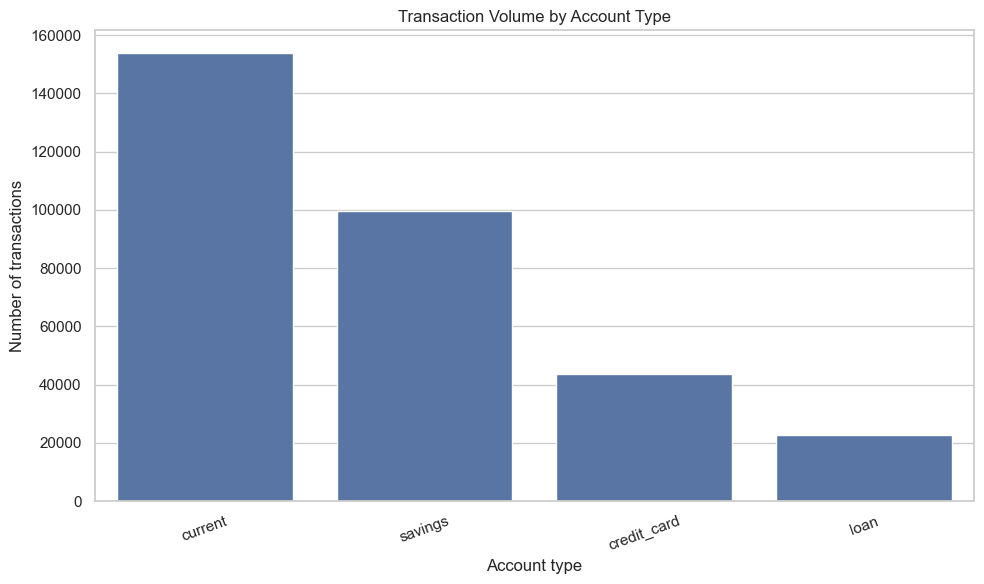
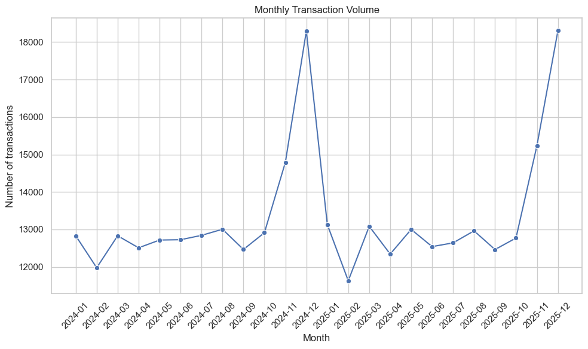
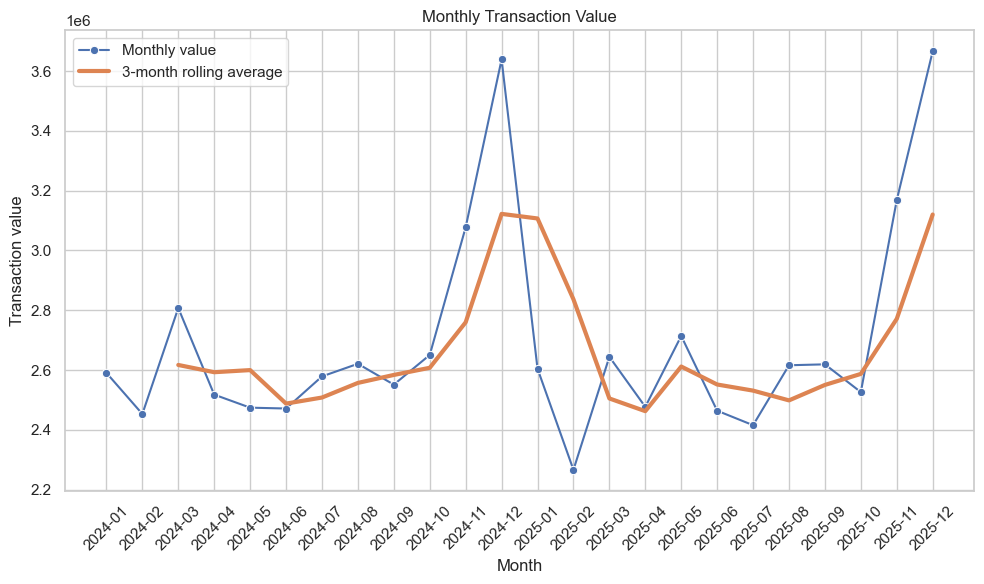
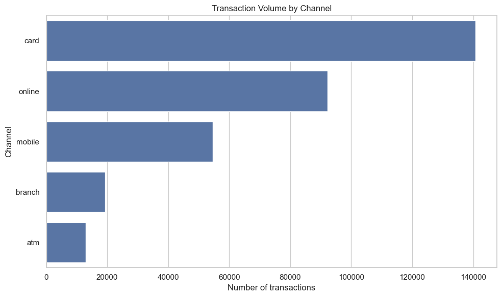
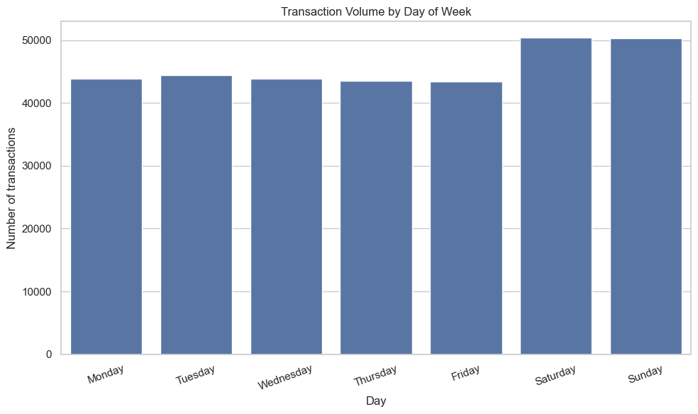
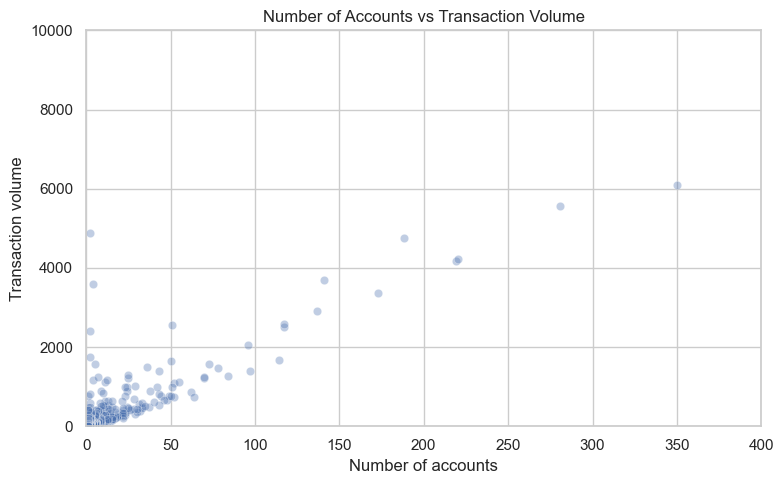

# Retail Banking Transaction Analysis

An exploratory data analysis project examining transaction behaviour across customers, accounts, time periods, channels and merchant categories. The project uses **Python, Pandas, DuckDB, NumPy and[...] 

## Research question

**How do customer and account characteristics relate to banking transaction behaviour and value?**

The analysis covers transaction distributions, customer activity, account types, time-based patterns, transaction channels, merchant categories, statistical relationships and reconstructed account [...]

## Key findings

These findings are drawn from the saved outputs in `notebooks/Analysis.ipynb`. They describe this dataset and should not be generalised to real banking customers without further validation.

- **Transaction amounts are strongly right-skewed.** Across 320,000 transactions, the mean amount is **201.92**, while the median is **28.02**. The 95th percentile is **1,540.00**, showing that a [...]
- **December is the busiest month in both observed years.** The notebook records **18,296 transactions in December 2024** and **18,305 in December 2025**. Monthly totals should be interpreted in t[...]
- **Weekend activity is higher than weekday activity.** Saturday has **50,461 transactions** and Sunday has **50,274**, compared with roughly 43,500–44,400 on each weekday.
- **Groceries is the most active merchant category.** It accounts for **45,782 transactions**, with a total transaction value of **2,239,891.22** in the dataset's amount units.
- **Current accounts have the highest transaction volume by account type.** The notebook reports **153,937 transactions** associated with current accounts, followed by **99,692** for savings accou[...]
- **Account count and transaction volume have a strong positive correlation** in the notebook's customer-level analysis (Pearson correlation **0.984**). This is an association, not evidence that h[...]
- **Customer tenure has little linear relationship with transaction volume** in this analysis. The reported Pearson correlation is **0.039**, close to zero. This does not rule out nonlinear relati[...]

> **Data interpretation note:** The dataset includes accounts with different currency labels. Unless amounts are converted to a common basis, summed transaction values should be treated as dataset[...]

## Selected visualisations

### Transaction volume by account type


### Monthly transaction volume


### Monthly transaction value


### Transaction volume by channel


### Transaction volume by day of week


### Customer account count and transaction volume


More charts are available in the notebook, including top customers by transaction volume and average transaction activity by customer risk band.

## Project structure

```text
banking-analysis/
├── assets/
│   └── charts/                 # Exported charts used in this README
├── data/
│   └── raw/
│       ├── accounts.parquet
│       ├── branches.parquet
│       ├── customers.parquet
│       ├── merchants.parquet
│       └── transactions.parquet
├── notebooks/
│   └── Analysis.ipynb
└── SQL/
    └── analysis.sql
```

- **`notebooks/Analysis.ipynb`** — data exploration, feature engineering, customer/account analysis, statistical summaries and visualisations.
- **`SQL/analysis_cleaned.sql`** — SQL queries for transaction and customer summaries, time trends, categories, account activity and reconstructed balances.
- **`data/raw/`** — source data in Parquet format.
- **`assets/charts/`** — selected charts exported from the notebook for display in this README.

## Analysis workflow

### 1. Data exploration and feature engineering
- Inspects the source tables and transaction amounts.
- Calculates descriptive statistics, including mean, median, standard deviation and quantiles.
- Extracts month, year, day of week and hour from transaction timestamps.
- Creates signed transaction amounts, treating credits as positive and debits as negative.

### 2. Customer behaviour
- Ranks customers by transaction count and total transaction value.
- Summarises customer-level activity.
- Applies standard-deviation-based thresholds to flag unusually high or low activity.

### 3. Account analysis
- Compares transaction volume, total value and average transaction size across account types.
- Identifies accounts with unusually high transaction counts.

### 4. Time-series analysis
- Examines monthly transaction counts and values.
- Compares debit and credit activity over time.
- Analyses activity by month, day of the week and hour.
- Calculates month-on-month changes and a three-month rolling average.

### 5. Channels and merchant categories
- Compares transaction volume and value across transaction channels.
- Analyses merchant categories by transaction count, total value and average transaction value.
- Screens for categories with unusually high or low average transaction values.

### 6. Statistical relationships
- Examines the relationship between account count and customer transaction volume.
- Investigates the relationship between customer tenure and transaction volume.
- Compares activity across account types and customer risk bands.

### 7. Reconstructed account balances
- Calculates signed transactions and cumulative running balances by account.
- Identifies accounts with high or low reconstructed balances.
- Compares negative reconstructed balances with recorded overdraft limits.

## Tools and technologies

- **Python**
- **Pandas** — data manipulation and aggregation
- **DuckDB** — querying Parquet data
- **NumPy** — numerical calculations and conditional classifications
- **Matplotlib and Seaborn** — visualisation
- **SQL** — joins, aggregations, common table expressions and window functions
- **Jupyter Notebook** — interactive analysis
- **Parquet** — columnar data storage

## Getting started

### Install dependencies

```bash
pip install pandas duckdb numpy matplotlib seaborn jupyter pyarrow
```

### Run the notebook

1. Download or clone the repository while preserving its folder structure.
2. Install the dependencies listed above.
3. Start Jupyter from the project root:

   ```bash
   jupyter notebook
   ```

4. Open `notebooks/Analysis.ipynb` and run the cells in order.

The notebook expects the Parquet files under `data/raw/`. If paths fail because your working directory differs, update the relevant file paths in the notebook.

### Run the SQL analysis

The SQL file expects the referenced tables to be available to the SQL engine. With DuckDB, create or register views over the Parquet files before executing the queries. Check SQL dialect compatib[...]

## Limitations and interpretation

- **Association is not causation.** Group differences and correlations do not establish causal relationships.
- **Outlier flags are not fraud findings.** Standard-deviation thresholds are exploratory screening methods and may be sensitive to skewed distributions.
- **Reconstructed balances are estimates.** The SQL analysis assumes an opening balance of zero because an opening balance is not provided. These are not actual bank statement balances.
- **Currency comparability needs checking.** Accounts have currency labels; transaction values should not be combined across currencies unless amounts have been converted consistently.
- **Join and data-quality issues can affect results.** Validate missing values, duplicate identifiers, join cardinality and date coverage before drawing conclusions.
- **Findings are dataset-specific.** They should not be generalised to real banking customers without further validation.

## Author

Sam Noruouzi.

---
